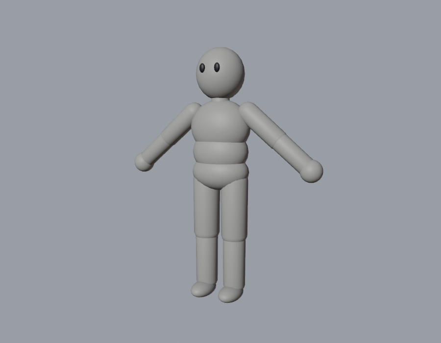

# Active Ragdoll

**A physics-driven, wobbly character controller for Unity 6** (Gang Beasts / Human Fall Flat style).

[English](#english) · [Türkçe](#türkçe)

<p align="center"></p>

---

<a name="english"></a>
# English

The character is moved by **physics, not animation**: joints try to hold a pose, balance forces
keep it upright, it falls over when something hits it, and it gets back up on its own.

- Ready-to-use character **Buddy** included
- Walk, turn, jump
- Reach and grab with either arm: carry boxes, hang from ledges
- Knockout when it tips over or takes a hard hit, then stands back up
- Third-person camera, keyboard + gamepad

**Requirements:** Unity 6 (6000.0+), Input System package.

## Step-by-step setup

### 1. Add the package to your project

1. In Unity, open **Window > Package Manager**.
2. Click the **+** button in the top-left → **Install package from git URL…**
3. Paste this URL and click **Install**:

   ```
   https://github.com/Atthree/ActiveRagdoll.git
   ```

The Input System package is installed automatically if it's missing. If Unity asks
*"Enable the new input backends?"*, click **Yes**; the Editor restarts.

> To lock a specific version, add a tag to the URL: `…/ActiveRagdoll.git#v0.1.1`

### 2. Prepare the scene

1. **File > New Scene** → the *Basic (URP)* or *Standard* template.
2. Add a floor: **GameObject > 3D Object > Plane**. In the Inspector set **Scale** to `5, 1, 5`.
   (The floor needs a **Collider**. A Plane already has one.)

### 3. Put the character in the scene

1. In the **Project** window open **Packages > Active Ragdoll > Characters**.
2. Drag **Buddy** into the Hierarchy or the scene.
3. In the Inspector set **Position** to `0, 0, 0` and **Rotation** to `0, 0, 0`.
   The character must stand upright with its feet on the floor.

### 4. Build the ragdoll

1. Open **Tools > Active Ragdoll > Builder**.
2. Drag **Buddy** from the Hierarchy into the window's **Karakter** (Character) field.
3. Click **Build**.

The builder:

- Adds a Rigidbody, colliders and a ConfigurableJoint to every bone. Collider sizes are measured
  from the mesh.
- Adds the `ActiveRagdoll`, `ActiveRagdollLocomotion`, `ActiveRagdollArms` and
  `PlayerRagdollInput` components to Buddy.
- Adds `RagdollCamera` to the **Main Camera** so it follows the character.

Everything can be undone with **Ctrl+Z**. The window also has a **Remove** button.

### 5. Play

Press **Play**.

| Keyboard / Mouse | Gamepad | Action |
|---|---|---|
| W A S D | Left stick | Walk (relative to the camera) |
| Space | A | Jump |
| Left click (hold) | Left trigger | Reach with the left arm, grab what it touches |
| Right click (hold) | Right trigger | Reach with the right arm, grab what it touches |
| Mouse | Right stick | Rotate the camera |
| Esc | – | Release the cursor (click the game view to lock it again) |

To try grabbing, add a few cubes to the scene and give them a **Rigidbody**.

## Tuning

Select Buddy to see every setting in the Inspector. You can change values during Play mode and
see the result immediately. Changes made in Play mode are lost when you stop, so write down the
values you like.

| Problem / Wish | Component → Field |
|---|---|
| Walk faster / slower | `ActiveRagdollLocomotion` → **Move Speed** |
| Jump higher | `ActiveRagdollLocomotion` → **Jump Speed** |
| Leans too far forward / back | `ActiveRagdoll` → **Balance Spring** (raise it) |
| Feet drag on the ground | `ActiveRagdoll` → **Stand Height Offset** (0.02 → 0.05) |
| Gets knocked out too easily | `ActiveRagdoll` → **Knockout Impact Speed** (raise it) or turn off **Auto Knockout** |
| Looser / stiffer body | `ActiveRagdoll` → **Joint Spring** |
| Arms can't lift what they hold | `ActiveRagdollArms` → **Reach Strength** |
| Grip breaks too easily | `RagdollHand` on the hand bones → **Break Force** |
| Camera distance / sensitivity | Main Camera → `RagdollCamera` → **Distance**, **Mouse Sensitivity** |
| Jitter | **Edit > Project Settings > Time > Fixed Timestep** = `0.01` |

## Troubleshooting

- **The character falls immediately / floats in the air:** make sure the floor has a collider and
  the character stands on it before you press Play (Position Y = floor height).
- **Keys do nothing:** **Edit > Project Settings > Player > Active Input Handling** must be
  *Input System Package (New)* or *Both*.
- **The builder says "Bulunamayan kemikler" (missing bones):** select the character in the scene,
  not the asset in the Project window. If you use your own character, import it with a
  **Humanoid** rig.
- **The character is pink:** if the project uses URP, convert the materials with
  **Window > Rendering > Render Pipeline Converter**.

## How it works

```
PlayerRagdollInput ─┐         (or your own AI script)
                    ▼
            RagdollCommands   (move direction, look direction, jump, grab)
                    │
     ┌──────────────┼───────────────────┐
     ▼              ▼                   ▼
ActiveRagdoll   ActiveRagdollLocomotion  ActiveRagdollArms
 joint strength, move force,              arm poses,
 upright torque, leg swing,               RagdollHand (grab)
 hip spring,     jump
 knockout
     │
     ▼
RagdollBone  (on every bone: Rigidbody + ConfigurableJoint)
```

- **Hip spring:** a spring holds the hips at a fixed height above the ground. The legs carry no
  weight; they only step for the look. This is the robust approach used by games like Human Fall
  Flat.
- **Upright torque:** a PD controller applies torque to the hips and chest to keep them upright and
  facing the move direction.
- **Frictionless legs:** leg colliders have no friction, so feet brushing the ground can't hold the
  body back and tip it forward.
- **Knockout:** joint strength drops to zero and the body goes fully limp. When the timer ends,
  strength ramps back up and the balance and hip forces stand the character up again.

| File | Job |
|---|---|
| `Runtime/ActiveRagdoll.cs` | Joint strength, upright torque, hip spring, ground check, knockout |
| `Runtime/ActiveRagdollLocomotion.cs` | Move force, turning, jumping, procedural leg swing |
| `Runtime/ActiveRagdollArms.cs` | Arms hanging, swinging, reaching |
| `Runtime/RagdollHand.cs` | Sticks to what it touches with a FixedJoint |
| `Runtime/RagdollBone.cs` | One bone: target rotations relative to the rest pose |
| `Runtime/ConfigurableJointExtensions.cs` | Converts `targetRotation` into joint space |
| `Runtime/PlayerRagdollInput.cs` | Input System → `RagdollCommands` |
| `Runtime/RagdollCamera.cs` | Third-person camera |
| `Editor/RagdollBuilder.cs` | Bone detection and automatic setup |
| `Editor/SkinMeasure.cs` | Measures collider sizes from the mesh |

To drive the character from code (instead of `PlayerRagdollInput`):

```csharp
var ragdoll = GetComponent<ActiveRagdoll>();
ragdoll.commands.move = Vector3.forward;   // world direction, length 0..1
ragdoll.commands.jumpRequested = true;
ragdoll.Knockout(2f);                      // knock out for 2 seconds
```

## The Buddy character

Buddy was generated in Blender with a script (`Art~/make_buddy.py`); the source file is
`Art~/Buddy.blend`. To change its proportions and regenerate it, run this from the package folder:

```
blender -b -P Art~/make_buddy.py -- Characters
```

## License

[MIT](LICENSE.md)

---

<a name="türkçe"></a>
# Türkçe

Karakter animasyonla değil, tamamen **fizikle** hareket eder: joint'ler pozu tutmaya çalışır,
denge kuvvetleri onu ayakta tutar, bir şey çarpınca devrilir ve kendi kendine kalkar.

- Hazır karakter **Buddy** pakete dahil
- Yürüme, dönme, zıplama
- Kolları uzatıp tutma: kutu taşıma, kenara asılma
- Devrilince / sert çarpışmada bayılma, sonra ayağa kalkma
- 3. şahıs kamera, klavye + gamepad

**Gereksinimler:** Unity 6 (6000.0+), Input System paketi.

## Adım adım kurulum

### 1. Paketi projeye ekle

1. Unity'de **Window > Package Manager**'ı aç.
2. Sol üstteki **+** düğmesine bas → **Install package from git URL…**
3. Şu adresi yapıştır ve **Install**'a bas:

   ```
   https://github.com/Atthree/ActiveRagdoll.git
   ```

Input System paketi yoksa otomatik kurulur. Unity *"Enable the new input backends?"* diye sorarsa
**Yes** de; editör yeniden başlar.

> Belirli bir sürümü kullanmak için adresin sonuna etiket ekle: `…/ActiveRagdoll.git#v0.1.1`

### 2. Sahneyi hazırla

1. **File > New Scene** → *Basic (URP)* veya *Standard* şablonu.
2. Zemin ekle: **GameObject > 3D Object > Plane**. Inspector'da **Scale**'i `5, 1, 5` yap.
   (Zeminin bir **Collider**'ı olmalı. Plane'de zaten var.)

### 3. Karakteri sahneye koy

1. **Project** penceresinde **Packages > Active Ragdoll > Characters** klasörünü aç.
2. **Buddy**'yi Hierarchy'ye ya da sahneye sürükle.
3. Inspector'da **Position** = `0, 0, 0`, **Rotation** = `0, 0, 0` olsun.
   Karakter dik durmalı ve ayakları zemine değmeli.

### 4. Ragdoll'u kur

1. Menüden **Tools > Active Ragdoll > Builder**'ı aç.
2. Hierarchy'deki **Buddy**'yi pencerenin **Karakter** alanına sürükle.
3. **Build**'e bas.

Builder şunları yapar:

- Her kemiğe Rigidbody, collider ve ConfigurableJoint ekler. Collider boyutları mesh'ten ölçülür.
- Buddy'nin üstüne `ActiveRagdoll`, `ActiveRagdollLocomotion`, `ActiveRagdollArms` ve
  `PlayerRagdollInput` bileşenlerini ekler.
- **Main Camera**'ya `RagdollCamera` ekleyip karakteri takip ettirir.

Hepsi **Ctrl+Z** ile geri alınabilir. Kurulumu silmek için pencerede **Remove** düğmesi var.

### 5. Oyna

**Play**'e bas.

| Klavye / Fare | Gamepad | İş |
|---|---|---|
| W A S D | Sol stick | Yürü (kameranın baktığı yöne göre) |
| Space | A | Zıpla |
| Sol tık (basılı tut) | Sol tetik | Sol kolu uzat, değdiğini tut |
| Sağ tık (basılı tut) | Sağ tetik | Sağ kolu uzat, değdiğini tut |
| Fare | Sağ stick | Kamerayı döndür |
| Esc | – | İmleci serbest bırak (oyun ekranına tıklayınca geri kilitlenir) |

Tutmayı denemek için sahneye birkaç küp koy ve onlara **Rigidbody** ekle.

## Ayarlar

Tüm ayarlar Buddy'yi seçince Inspector'da görünür. Play modundayken değiştirip sonucu anında
görebilirsin. Play'den çıkınca değişiklikler geri alınır; beğendiğin değerleri not et.

| Sorun / İstek | Bileşen → Alan |
|---|---|
| Daha hızlı / yavaş yürüsün | `ActiveRagdollLocomotion` → **Move Speed** |
| Daha yükseğe zıplasın | `ActiveRagdollLocomotion` → **Jump Speed** |
| Fazla öne / arkaya eğiliyor | `ActiveRagdoll` → **Balance Spring** (artır) |
| Ayaklar yere sürtüyor | `ActiveRagdoll` → **Stand Height Offset** (0.02 → 0.05) |
| Çok kolay bayılıyor | `ActiveRagdoll` → **Knockout Impact Speed** (artır) veya **Auto Knockout** kapat |
| Daha gevşek / daha sert gövde | `ActiveRagdoll` → **Joint Spring** |
| Kollar tuttuğunu kaldıramıyor | `ActiveRagdollArms` → **Reach Strength** |
| Tutuş çok kolay kopuyor | El kemiklerindeki `RagdollHand` → **Break Force** |
| Kamera uzaklığı / hassasiyeti | Main Camera → `RagdollCamera` → **Distance**, **Mouse Sensitivity** |
| Titreme | **Edit > Project Settings > Time > Fixed Timestep** = `0.01` |

## Sorun giderme

- **Karakter Play'de hemen düşüyor / havada asılı kalıyor:** Zeminde collider olduğundan ve
  karakterin Play'den önce zemine bastığından emin ol (Position Y = zeminin yüksekliği).
- **Tuşlar çalışmıyor:** **Edit > Project Settings > Player > Active Input Handling** değeri
  *Input System Package (New)* ya da *Both* olmalı.
- **Builder "Bulunamayan kemikler" diyor:** Sahnedeki karakteri seçtiğinden emin ol (Project'teki
  asset'i değil). Kendi karakterini kullanıyorsan model **Humanoid** rig olarak import edilmeli.
- **Karakter pembe görünüyor:** Proje URP kullanıyorsa materyalleri
  **Window > Rendering > Render Pipeline Converter** ile dönüştür.

## Nasıl çalışıyor?

Mimari şeması ve dosya listesi için yukarıdaki [How it works](#how-it-works) bölümüne bak.

- **Kalça yayı:** Kalça yerden belli bir yükseklikte bir yayla tutulur. Bacaklar ağırlık taşımaz,
  sadece görsel olarak adım atar. Human Fall Flat tarzı oyunlarda kullanılan sağlam yöntem budur.
- **Dik durma:** Kalçaya ve göğse, dik durup hareket yönüne dönmeleri için tork uygulanır
  (PD kontrolcü).
- **Sürtünmesiz bacaklar:** Bacak collider'larında sürtünme yoktur. Böylece yere değen ayaklar
  gövdeyi geride tutup öne devirmez.
- **Bayılma:** Joint gücü sıfıra iner, karakter tam ragdoll olur. Süre bitince güç yavaşça geri
  gelir, denge ve kalça yayı karakteri ayağa kaldırır.

Koddan kontrol etmek istersen (`PlayerRagdollInput` yerine):

```csharp
var ragdoll = GetComponent<ActiveRagdoll>();
ragdoll.commands.move = Vector3.forward;   // dünya yönü, uzunluk 0..1
ragdoll.commands.jumpRequested = true;
ragdoll.Knockout(2f);                      // 2 saniye bayılt
```

## Buddy karakteri

Buddy, Blender'da scriptle üretildi (`Art~/make_buddy.py`). Kaynak dosya `Art~/Buddy.blend`.
Ölçüleri değiştirip yeniden üretmek için paket klasöründe şunu çalıştır:

```
blender -b -P Art~/make_buddy.py -- Characters
```

## Lisans

[MIT](LICENSE.md)
